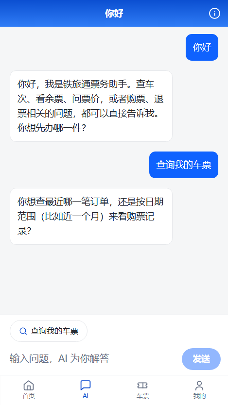
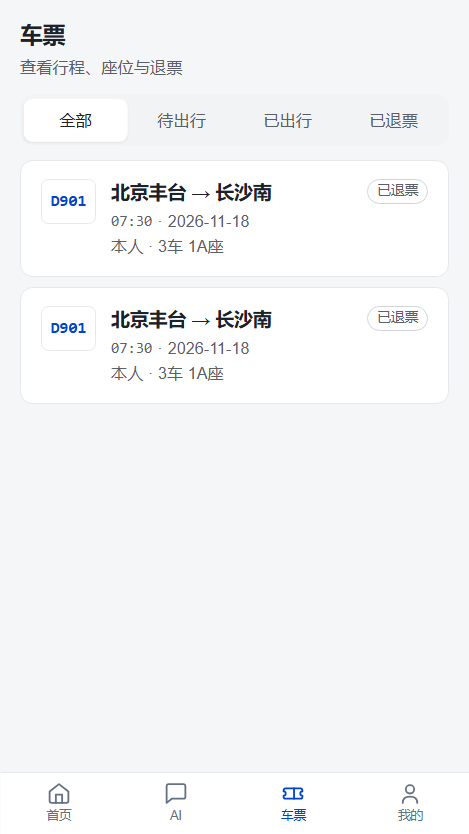
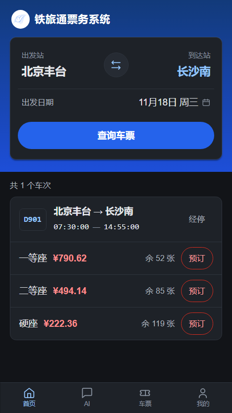
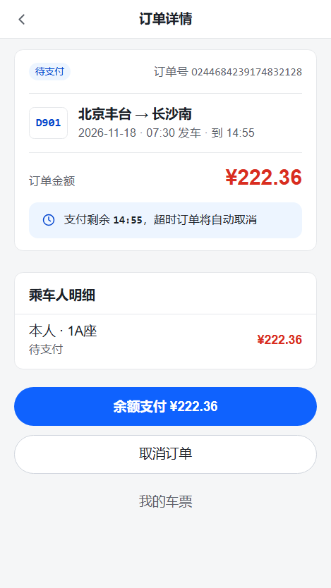
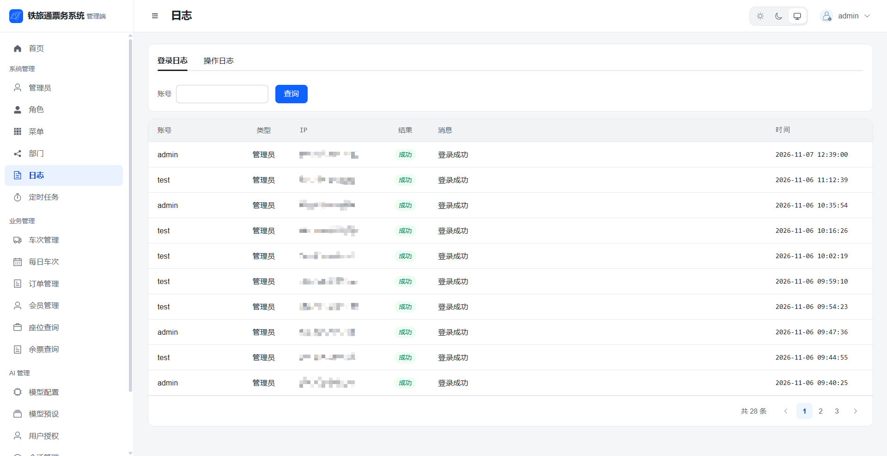
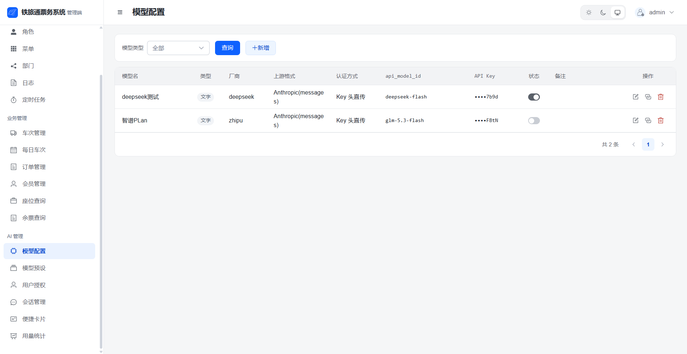
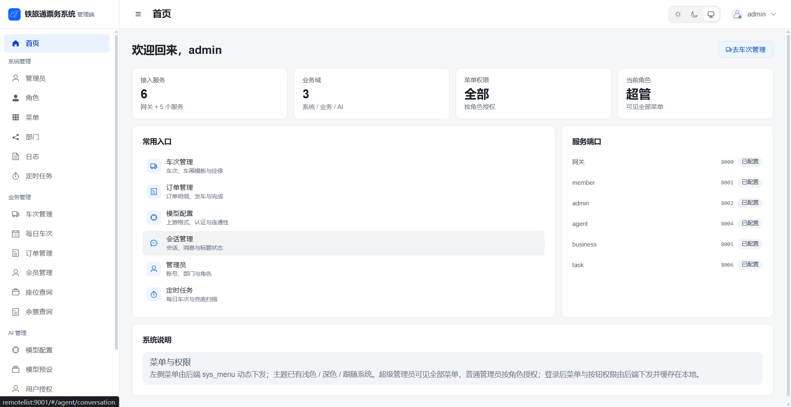
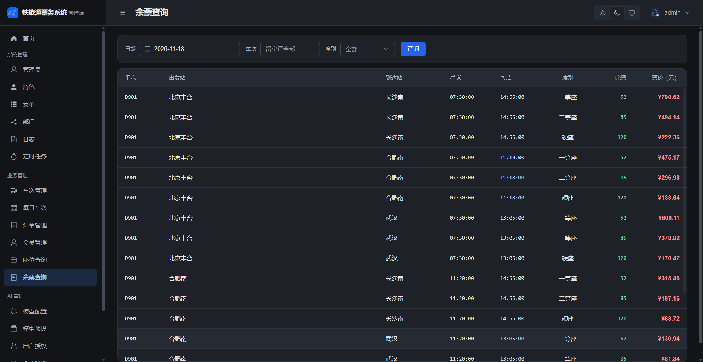

# 铁旅通票务系统

## 项目介绍

一个仿 12306 的铁路购票微服务系统：覆盖注册登录、余票查询、选座下单、钱包支付、退票的完整用户链路，以及车次维护、RBAC 权限、定时任务管理台等管理能力；另含已落地的 AI 智能问询服务：SSE 流式对话、查票/购票/退票预检工具、长期记忆、模型配置管理与会话运营后台。

重点解决购票场景的三个核心问题：**不超卖、不重复扣座**（sell 位图 + 锁座与订单同一本地事务 + 订单状态机 CAS + 幂等锚点）；**跨服务一致性**（不引 Seata，用 RocketMQ 事务消息 / 延迟消息 + 兜底扫描 + 对账补偿，支付等待窗口不占用事务）；**安全合规**（网关统一鉴权、RSA 传输加密、敏感字段 AES 加密存储）。

技术栈：JDK 21 · Spring Boot 4 · Spring Cloud 2025.1 + Alibaba（Nacos / OpenFeign / Gateway）· RocketMQ 5 · MySQL / PostgreSQL · MyBatis-Plus · Redis + Redisson · Shiro + JWT · Vue 3。

## 主要功能

**用户端（H5，`train-ui/web`）**

- 会员注册 / 登录（JWT 令牌鉴权；密码 RSA 加密传输，支持短信验证码登录），登录失败锁定保护
- 乘车人管理（增删改查，证件号 AES 加密存储、脱敏展示）
- 车站查询、按日期与区间查余票（结果缓存，秒级刷新）、车次经停展示
- 选座下单：系统连座优先分配 或 自选座位，支持图形验证码防刷（高频下单触发）
- 钱包：余额与流水、按档位充值、下单扣款、退款入账（余额硬区间 `[0, 1000]`，应用层 + 数据库 CHECK 双重校验，资金变动必有流水）
- 订单：待支付 / 已支付 / 已出行 / 已完成 / 已退款等状态归组流转，我的订单与我的车票
- 超时未支付自动关单并释放座位（延迟消息 + 兜底扫描双保险）
- **AI 交流**：SSE 流式回复（Markdown 渲染、思考中动画）、发送即贴底、上滑分页加载历史（一页 10 轮）、快捷卡片、错误以消息形式呈现
- AI 会话与记忆：账户级单主会话（72h 空闲自动翻篇）、标题自动生成、长期记忆异步提炼（可按开关维护）、记忆管理

**管理端（`train-ui/admin`）**

- 管理员登录（RSA 加密传输），部门 / 角色 / 菜单三级权限体系（按钮级鉴权）
- 车次 / 车站 / 经停 / 车厢座位维护，每日生成未来第 N 天车次（滚动覆盖）
- 座位查询 / 余票查询页面；会员治理（查询、启用停用、重置密码）；订单与支付对账
- **定时任务管理台**：Quartz 任务的可视化管理（新增/编辑/暂停/恢复/手动执行），白名单防任意类执行
- 登录日志与操作日志（跨服务 MQ 异步落库）
- **AI 管理**：模型配置（预设一键接入、连通性测试、拉取上游模型列表）、模型预设、用户授权与每日配额、会话管理（消息查看、标题重新生成）、便捷卡片、用量统计

**工程设计亮点**

- **不引 Seata，用补偿换一致**：AT 全局事务几分钟自动回滚，与延时支付天然冲突；跨服务一致性 = RocketMQ 事务消息 / 延迟消息 + 兜底扫描 + 对账补偿。
- **支付等待窗口不处于任何打开的事务中**：下单即提交（锁座 + 订单一个短事务，Redis 锁包裹到提交后）→ 延迟消息到期按订单实际截止时间复判（未到期 re-arm 接力）→ 关单短事务。
- **订单状态机全部 CAS 条件更新**：`待支付→已支付→已出行→已完成`，另有 `待支付→已取消`、`已支付→退款中→已关闭` 分支，不直接 setStatus。
- **sell 位图拼座**：一个字符串记录座位在各站区间的占用（`0` 可售 / `1` 已售），同一座位不重叠区间可拼卖，扣座 / 退座都是一次位图更新。
- **幂等锚点**：座位释放以 `b_seat_occupy.status` 条件更新（1 占用 → 2 已释放）防重复回补余票；退款走 `b_refund_batch` 申请→入账→确认三段式；钱包扣款 / 入账幂等。
- **全链路追踪**：统一头 `X-Trace-Id`（16 位小写十六进制），网关 → 服务过滤器（MDC）→ Feign 出站 → MQ 消息属性 → Quartz Job 全覆盖，任一环缺失即在网关重新生成。
- **纵深安全**：网关清洗伪造头 + 白名单 + JWT 验签 + 注入身份头；密码 RSA 加密传输、身份证 / api_key AES 加密存储；Shiro 3 无状态鉴权、滑窗限流、登录失败锁定。
- **agent 域运行时设计**：预设是模板、配置是快照（一键接入全量拷贝，此后互不影响）；不用 Spring AI starter 自动装配，客户端按 modelId 动态构造并按需缓存，配置变更经事件即时失效；api_key AES 加密存储、出参只回显尾 4 位；向量模型同一时间仅一个启用。
- **思考内容按协议字段过滤**：Anthropic 协议把思考拆成独立块/独立增量，流式跳过 thinking 增量、非流式取首个非思考 Generation；`<think>` 标签剥离仅作为内联混写厂商的兜底。
- **聊天失败可收尾**：业务失败以固定文案作为本轮回复落库并返回 SSE error；用量/落库等收尾任一步异常都释放主回复占用，不会把用户卡在“思考中”。
- **记忆异步链路**：整轮消息与任务 Outbox 同事务提交，Relay 投递、Consumer 提炼；消费状态机支持 PENDING/SENT 双状态消费，避免“先发消息、后回写状态”的竞态丢任务。

## 功能截图

**用户端（H5）**

<p>
  
  
</p>
<p>
  
  
</p>

**管理端**

**日志**



**模型配置**



**首页**



**余票查询**



## 技术栈

| 层             | 选型 |
|----------------|---|
| 语言           | JDK 21 · Spring Boot 4.0.2 · Jackson 3 |
| 微服务         | Spring Cloud 2025.1.1 · Spring Cloud Alibaba 2025.1.0.0（Nacos 注册与配置中心、OpenFeign、Gateway） |
| 消息           | RocketMQ 5（事务消息 / 延迟消息 / 普通事件，统一封装在 common-mq 的 MqSender + re-arm 档位工具） |
| 任务           | Quartz（JDBC 持久化 + 管理台手动注册，集中在 train-task） |
| 数据           | MySQL 8（主仓四库）/ PostgreSQL + pgvector（agent）· MyBatis-Plus（逻辑删除、AES TypeHandler、分页方言可配）· HikariCP |
| 缓存 / 并发    | Redis · Redisson（分布式锁、滑窗限流、业务缓存、RSA 密钥 / 登录失败计数） |
| 安全           | jjwt（JWT 签发验签，超管标识入 token）· Shiro 3 无状态鉴权（jakarta，手动装配）· BCrypt · RSA 传输加密 · AES 字段加密 |
| AI（agent 域） | Spring AI 2.0（spring-ai-bom 由 train-agent 自管，排除 starter 自动装配）· pgvector 向量存储 |
| 文档 / 其他    | springdoc（Swagger）· Lombok · Vite + Vue 3 前端 |

## 系统架构

```
浏览器（H5 :5173 / 管理端 :5174，本地 vite dev）
        │  统一入口 /api/**
        ▼
train-gateway 网关 :8000 ── 清洗伪造头 → 白名单放行 → JWT 验签
        │               → 注入用户身份头（含超管标识） → 路径改写 → 负载转发
        ├── /api/member/** ──▶ train-member  会员域 :8001（ntrain_member 库）
        ├── /api/admin/**  ──▶ train-admin   系统域 :8002（ntrain_admin 库，管理面经 Feign 调 train-agent）
        ├── /api/task/**   ──▶ train-task    任务域 :8006（ntrain_task 库，仅 QRTZ_ 表）
        └── /api/agent/**  ──▶ train-agent   智能问询域 :8004（ntrain_agent 库 @ PostgreSQL）
                                     │
                OpenFeign（business-api / member-api / agent-api 契约 jar）
                                     ▼
        train-business 业务域 :8005（ntrain_business 单库：列车 + 订单两个子域）
                  · 下单 = 锁座 + 订单落库同一本地事务（Redis 锁包裹到提交后）
                  · 关单/退款 = 状态 CAS + 座位释放同一本地事务 + 事务消息广播
                  · 超时关单 = 延迟消息（档位覆盖 + re-arm 复判）+ task 兜底扫描

train-agent 智能问询域 :8004（ntrain_agent 库 @ PostgreSQL）
                  · 用户侧 /api/agent/ai/**（SSE 聊天、会话、记忆、快捷卡片）走网关
                  · 管理面 admin-server ──Feign(agent-api)──▶ agent-server /ag/**（不经网关）

中间件与数据库（均在远程服务器 remotelist）：MySQL · Redis · Nacos · RocketMQ namesrv+broker
```

架构要点：

1. **一域一库**：business（列车+订单，单库本地事务）/ member（账号+钱包）/ admin（RBAC）/ task（QRTZ_）各连自己的库，域内多表操作是普通本地事务；agent 独立用 PostgreSQL（时间列 TIMESTAMPTZ，向量数据由 Spring AI `vector_store` 自建自管）。
2. **不引 Seata**：其 AT 全局事务几分钟自动回滚，与延时支付天然冲突；跨服务一致性交给 RocketMQ 补偿机制。
3. **支付等待窗口不处于任何打开的事务中**：下单即提交 → 延迟消息到期复判（未到期 re-arm 接力）→ 关单短事务；train-task 的关单兜底扫描每分钟扫漏网。
4. **跨服务一致性 = RocketMQ 补偿**：关单/退款确认用**事务消息**（本地事务与事件原子生效，member 失效缓存）；支付 = member 钱包幂等扣款 → business 确认，失败冲正；退款确认中断由对账扫描重试。
5. **契约式接口**：`business-api / member-api / agent-api` 一份定义两处使用——消费端是 Feign 客户端，服务端 Controller 直接 `implements` 接口；agent 管理面即由 admin-server 经 `agent-api` 调用 `/ag/**`。
6. **全链路追踪横切**：`X-Trace-Id` 网关 `TraceIdGlobalFilter` → 服务入口 `TraceIdFilter`（写 MDC + 回写响应头）→ Feign 出站拦截器 → `MqSender` 消息属性 → `TraceIdMqListener` 消费恢复 → Quartz 任务继承 `TraceIdJob`。

## 模块结构

```
ntrain
├── train-common                 公共件（六个模块兄弟间零依赖，按需引用；agent 域同源复用）
│   ├── common-core              统一返回体、分页、常量（含订单状态）、AES 三件套、JacksonUtil、TraceIdSupport
│   ├── common-web               全局异常处理、TraceIdFilter（MDC + 响应头）、Web 公共装配
│   ├── common-mybatis           MyBatis-Plus 公共配置 + AesCryptoTypeHandler + 分页方言（ntrain.mybatis.db-type）
│   ├── common-redis             Redisson（分布式锁/滑窗限流/RedisService/RSA 密钥/登录失败锁定，Jackson 2 codec）
│   ├── common-security          JwtUtil（含超管声明）、登录上下文、权限注解
│   └── common-mq                MqSender（普通/延迟/事务 + re-arm 档位工具）+ 事件契约 + TraceIdMqListener
├── train-business
│   ├── business-api             业务域契约：车站/车次/每日车次/余票/订单/支付/退款/巡检触发
│   └── business-server          业务域服务 :8005：生成每日车次、余票、位图锁座（本地事务）、
│                                订单状态机、自选座、超时关单（延迟消息）、上下车过站巡检
├── train-member
│   ├── member-api               会员域契约：账号管理、重置密码、巡检触发（供 admin/task 调用）
│   └── member-server            会员域服务 :8001：账号/乘客/钱包/短信登录 + H5 BFF
├── train-admin                  系统域服务 :8002：RBAC/日志 + 管理端 BFF + MQ 日志消费
├── train-task                   任务域服务 :8006：Quartz JDBC + 任务管理台，6 个 Job 经 Feign 触发
│                                （新增定时任务必须继承 TraceIdJob，否则不进追踪链）
├── train-gateway                网关 :8000：路由（member/admin/task/agent）/ 认证 / 白名单 / TraceIdGlobalFilter / 跨域
├── train-agent                  智能问询域（板块①模型配置 ②会话消息 ④便捷卡片 ⑥用户端聊天已落地，③知识库与 RAG 预留）
│   ├── agent-api                管理面契约 jar：模型 / 预设 / 用户授权 / 会话 / 消息 / 卡片 / 用量 七组 Feign 接口
│   └── agent-server             智能问询服务 :8004：模型配置与动态客户端、SSE 聊天编排（意图路由 + 工具 + 安全）、
│                                长期记忆与会话摘要（Outbox + MQ）、快捷卡片；依赖 common-core/mybatis/redis/web/mq/security
└── train-ui                     前端：web（H5 用户端 :5173）+ admin（管理端 :5174）
```

依赖方向：应用只依赖其它域的 `*-api` 契约 jar 与所需 common 模块；agent-server 复用 common-core / common-mybatis / common-redis / common-web / common-mq / common-security（无专属公共库），并经 business-api / member-api 调用查票、乘车人与订单能力。可执行 jar 在 gateway / business-server / member-server / admin / task / agent-server 六个应用模块产出。
---

## 开源协议

本项目基于 [MIT License](LICENSE) 开源，可自由使用、修改、分发，保留版权声明即可。
